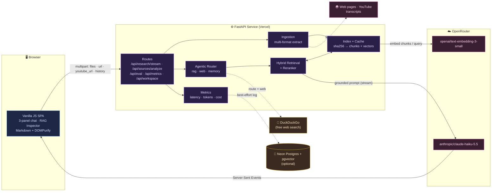
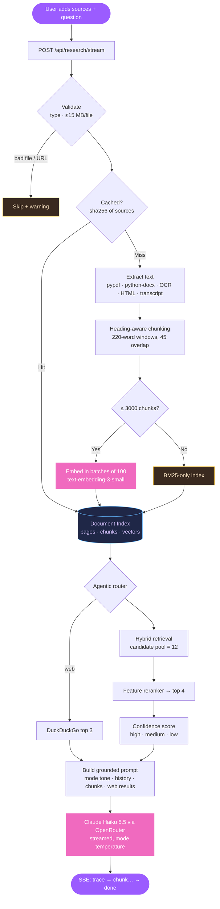
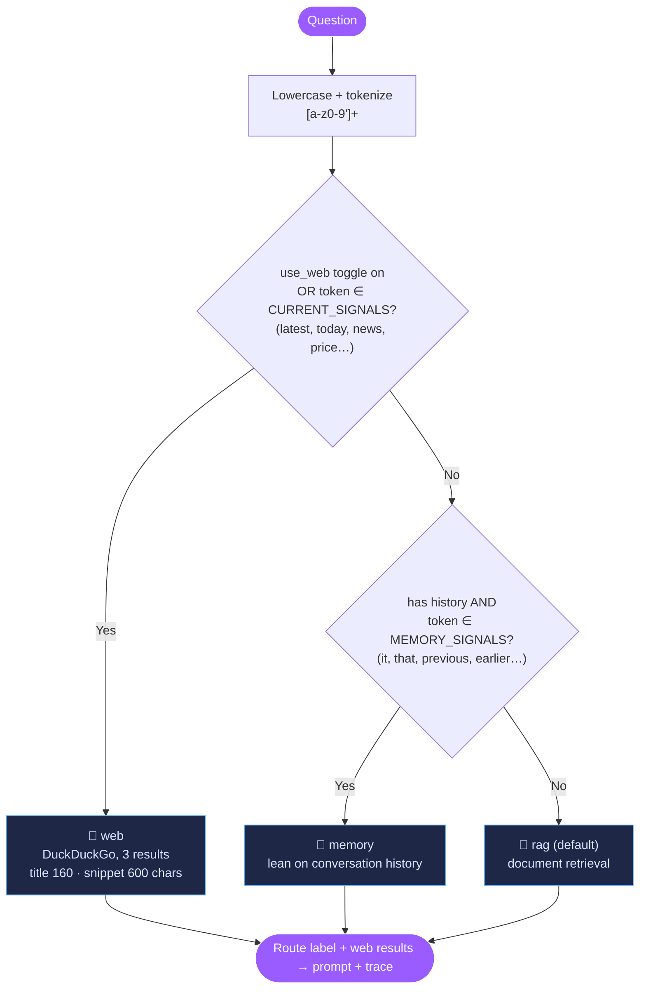
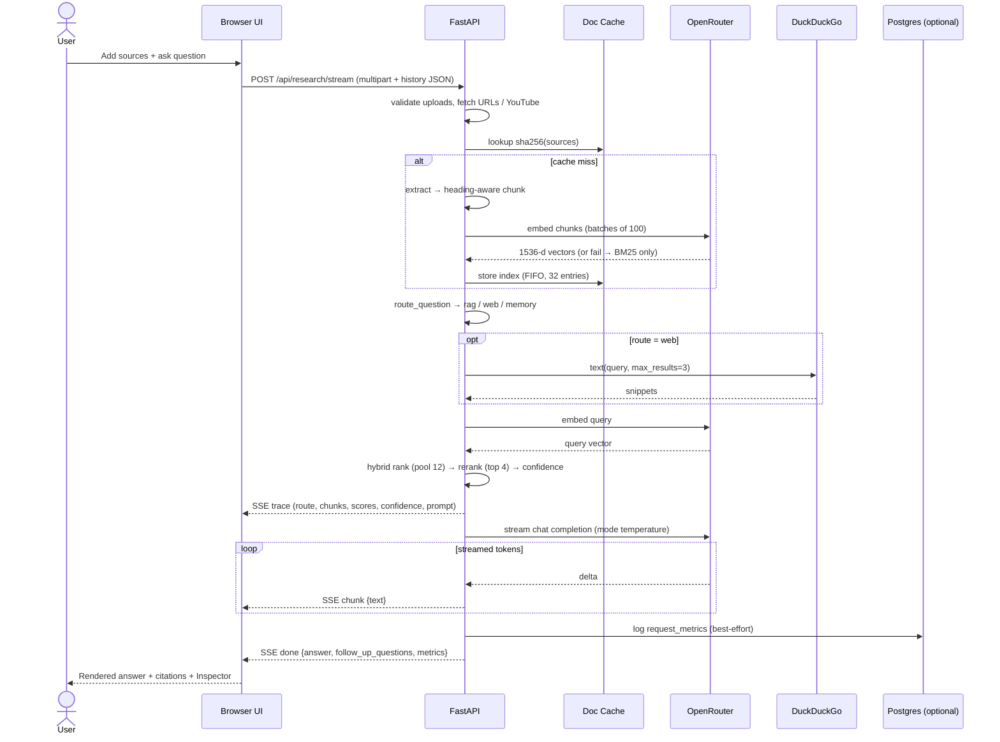
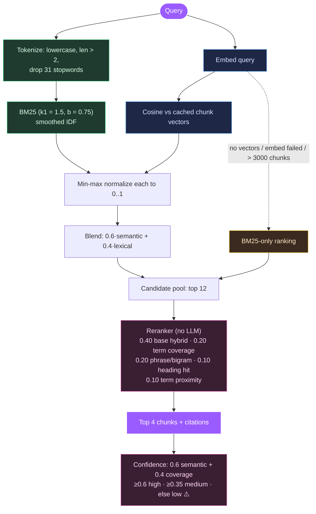
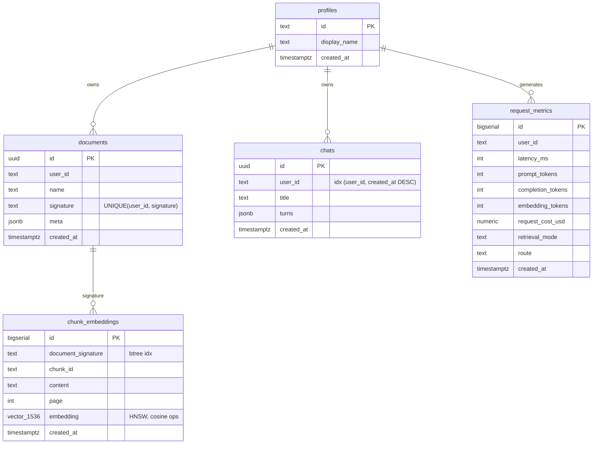
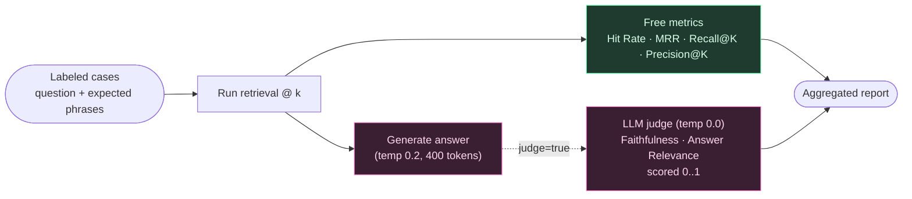

# 🧠 AI RAG Research Assistant (Researchly): System Design

### Visual architecture, data flow, and design decisions behind a source-grounded, multi-source RAG assistant

-4169E1?logo=postgresql&logoColor=white)

🌐 **Live app:** [ai-rag-research-assistant.vercel.app](https://ai-rag-research-assistant.vercel.app/) · 📦 **App repo:** [AI-RAG-Research-Assistant](https://github.com/Swarali108/AI-RAG-Research-Assistant) · 📝 **Case study:** [AI-RAG-Case-Study](https://github.com/Swarali108/AI-RAG-Case-Study)

---

## 📌 What this repo is

This is the **design companion** to the AI RAG Research Assistant (branded **Researchly** in the UI). It explains *how* the system fits together: the architecture, how a request moves through it, and the trade-offs behind each decision. It doesn't walk through the code line by line. The diagrams are Mermaid, so they render on GitHub.

> **One-line summary:** Add sources (PDF, DOCX, TXT/MD, images, web pages, YouTube, pasted text). The system extracts, chunks (heading-aware), and indexes them. An **agentic router** picks document RAG, web search, or conversation memory. **Hybrid retrieval (embeddings + BM25)** pulls a wide candidate pool, and a **feature-based reranker** narrows it to the best passages. Claude Haiku 5.5 (via **OpenRouter**) then streams a **cited, confidence-scored answer**.

### What changed since v1

| Area | v1 | Now |
| --- | --- | --- |
| Model gateway | Google Gemini API directly | **OpenRouter** (one-line model/provider swap) |
| Generation | `gemini-2.5-flash-lite` | **`anthropic/claude-haiku-5.5`** |
| Embeddings | Gemini `text-embedding-004` | **`openai/text-embedding-3-small`** (1536-d), batched 100 at a time |
| Sources | PDF only | PDF, DOCX, TXT, Markdown, images (OCR), web URLs, YouTube transcripts, pasted text |
| Chunking | Fixed 220-word windows | **Heading-aware** 220/45 windows, with the heading prepended to each chunk |
| Ranking | Hybrid top-k | Hybrid **candidate pool of 12 → reranked to top 4** |
| Routing | Always RAG | **Router**: `rag` / `web` (DuckDuckGo) / `memory` |
| Conversation | Single turn | Full conversation history sent with follow-ups |
| Answer modes | Research / Bestie | **6 modes**, each with its own temperature |
| Persistence | None | **Optional Neon Postgres + pgvector** (graceful no-op without it) |
| Quality | Unit tests | **Eval harness** (Hit Rate, MRR, Recall@K, Precision@K + opt-in LLM judge) and **`/api/metrics`** |

---

## 🗺️ 1. System Context

The big picture. A single FastAPI service serves the UI, runs ingestion and the RAG pipeline, and calls out to model, search, and storage providers. Every external dependency except OpenRouter is optional or fails soft.

---

## 🔄 2. RAG Pipeline: Data Flow

How a question travels from raw sources to a cited answer. The **cache check** is the main efficiency win: a source set is parsed and embedded **once**, not on every question.

---

## 🧭 3. Agentic Router

Each question goes down one of three paths. The router is **pure keyword matching**, so it costs nothing per request (no LLM call). It checks the rules in priority order:

> Document retrieval runs on **every** route, so answers stay grounded in the uploaded sources. The route decides what *extra* context goes into the prompt (web snippets or history emphasis). It also appears in the RAG Inspector and in metrics. If web search fails (package missing or network error), it returns `[]` and the answer continues without it.

---

## ⏱️ 4. Request Sequence

What happens on the wire for one streamed question.

---

## 🎯 5. Retrieval: Hybrid Search + Reranking

Keyword search alone misses synonyms ("downsides" vs "limitations"). Embeddings alone can drift on exact terms and names. Researchly therefore blends both to build a **wide candidate pool**, then uses a cheap, explainable **reranker** to pick the final passages.

> **Why it never breaks:** embedding is all-or-nothing. Any exception or count mismatch returns `None`, the ranker falls back to BM25-only, and the trace records `semantic: false`. The session fallback rate is tracked in `/api/metrics`, so silent degradation still shows up.

---

## 🧩 6. Component Breakdown

| Layer | Module | Responsibility | Key choices |
| --- | --- | --- | --- |
| **UI** | `src/static/` | Sources panel, chat, streaming, RAG Inspector, saved research, export | Vanilla JS, no build step; Markdown sanitized with DOMPurify; export to Markdown/PDF |
| **API** | `src/app.py` | Routing, validation, CORS, SSE, caching, embedding calls | `MAX_UPLOAD_MB` = 15; CORS from `ALLOWED_ORIGINS` |
| **Ingestion** | `src/ingestion.py` | Any source → pages of text | pypdf, python-docx, pytesseract OCR, stdlib HTML parser (15 s timeout, 200k chars), youtube-transcript-api; optional deps lazy-loaded |
| **Chunking** | `src/app.py` | Pages → chunks | Heading-aware (markdown, numbered, ALL-CAPS); 220-word windows, 45 overlap; heading prepended |
| **Embedding** | `src/app.py` | Chunk + query vectors | `text-embedding-3-small` via OpenRouter, batches of 100, skipped above 3000 chunks |
| **Cache** | `src/app.py` | Avoid re-parsing/embedding | `sha256(sources)` → index; in-process dict, FIFO-bounded to 32 |
| **Router** | `src/router.py` | Pick `rag` / `web` / `memory` | Keyword signals, zero LLM cost; DuckDuckGo via `ddgs` |
| **Retrieval** | `src/retrieval.py` | Rank chunks | Pure, dependency-light, unit-tested; BM25 + cosine hybrid |
| **Reranking** | `src/reranker.py` | Pool of 12 → top 4 | 5 explainable features, per-chunk `rerank_features` in the trace |
| **Memory** | `src/memory.py` | Follow-up context | Full conversation sent verbatim (no windowing/summarization) |
| **Insights** | `src/insights.py` | Key topics + suggested questions | One small cached LLM call per source set; free keyphrase fallback |
| **Generation** | `src/app.py` | Grounded, cited answer | Claude Haiku 5.5, streamed, reasoning off; temperature per mode |
| **Storage** | `src/storage.py` | Workspaces, metrics, vectors | psycopg 3, short-lived connections; every method no-ops without `DATABASE_URL` |
| **Evaluation** | `src/evaluation.py` | Measure quality | Retrieval metrics (free) + opt-in LLM-judge metrics |

### Answer modes

| Mode | Temperature | Style |
| --- | --- | --- |
| Research (default) | 0.2 | Precise, citation-heavy |
| 30-Second Summary | 0.2 | TL;DR |
| Interview | 0.3 | Interview-prep framing |
| Professor | 0.3 | Academic depth |
| Beginner | 0.4 | ELI5 |
| Bestie | 0.65 | Friendly, casual |

Each mode also has follow-up templates. These are combined with document-aware questions built from top retrieved terms, up to 4 suggestions, at no LLM cost.

---

## 🔌 7. API Surface

| Method | Path | Purpose |
| --- | --- | --- |
| `GET` | `/` | Serves the SPA (with an asset-version hash for cache busting) |
| `GET` | `/api/health` | Liveness check |
| `POST` | `/api/research/stream` | **Main path.** Streamed answer over SSE. Accepts `files`, `url[]`, `youtube_url[]`, `use_web`, `history`, `answer_mode` |
| `POST` | `/api/research` | Same pipeline, non-streamed, full trace in JSON |
| `POST` | `/api/sources/analyze` | Index sources; per-source status, pages, chunks, topics, suggested questions |
| `POST` | `/api/chat` | Plain chat with no documents |
| `GET` | `/api/eval?k=4&judge=false` | Run the bundled evaluation set |
| `GET` | `/api/metrics` | Session counters, fallback rate, model names |
| `GET` | `/api/account/status` | Whether persistence is enabled and who is signed in |
| `GET/POST` | `/api/workspace/{documents,chats}` | Persistent workspaces (Postgres + sign-in) |

### SSE event contract

| Event | Payload | When |
| --- | --- | --- |
| `trace` | route, web results, pages/chunks processed, warnings, retrieved chunks (scores, matched terms, rerank features), confidence, embedding summary, full prompt | Once, before generation starts |
| `chunk` | `{ text }` | Each streamed token delta |
| `done` | `{ answer, follow_up_questions, metrics }` | After generation completes |
| `error` | `{ message }` | Generation failure (errors before streaming starts return normal HTTP 4xx) |

---

## 🗄️ 8. Data Model (optional Postgres)

When `DATABASE_URL` points to Neon Postgres, the app gains persistent workspaces and stored metrics. The schema ([`db/schema.sql`](https://github.com/Swarali108/AI-RAG-Research-Assistant/blob/main/db/schema.sql)) also provisions pgvector storage for chunk embeddings.

- Relationships are **logical**, with no FKs. `user_id` is plain text so an external identity provider can issue the IDs, and every query is scoped by `user_id` in the backend.
- `match_chunks(sig, query_embedding, match_count)` is a SQL function that returns the top chunks by cosine similarity (`1 - (embedding <=> q)`) for one document.
- Without a database, every storage call returns a safe empty value and the app runs fully stateless.

---

## 📊 9. Observability & Evaluation

**Per-request metrics** are returned in the `done` event and aggregated at `/api/metrics`: `latency_ms`, embedding/prompt/completion tokens, `request_cost_usd`, `retrieval_mode` (hybrid vs BM25), route, session fallback rate, and session total cost. When Postgres is enabled, they're also logged to `request_metrics`.

**Evaluation harness** (`GET /api/eval`):

A chunk counts as relevant if it contains any expected phrase. The judge's reply is parsed as its first number and normalized from 0–10 or 0–100 scales when needed.

---

## ⚖️ 10. Design Decisions & Trade-offs

| Decision | Why | Trade-off accepted |
| --- | --- | --- |
| **Single self-contained FastAPI app** | Easy to deploy serverless on Vercel; no frontend build | Less separation than an SPA + API split |
| **OpenRouter as the only model gateway** | One key and one client for embeddings and generation; switching model or provider is a config change | Extra hop and a dependency on one aggregator |
| **Claude Haiku 5.5 for generation** | Fast and cheap with strong instruction-following for grounded, cited answers | Less depth than larger models on very long, complex synthesis |
| **API embeddings, not local models + FAISS** | No heavy model download or native build on serverless | Per-source-set embedding cost (softened by caching and the 3000-chunk cap) |
| **Hybrid retrieval + BM25 fallback** | Best of semantic and lexical search; it never fully breaks | More ranking logic to maintain |
| **Heuristic reranker, not a cross-encoder/LLM** | Zero added latency or cost; each feature is visible in the Inspector | Less nuanced than a learned reranker |
| **Keyword router, not an LLM classifier** | Free, deterministic, and testable offline | Misses intent that isn't phrased with signal words |
| **Full history, verbatim** | Simple, with no lossy summarization | Prompt grows with long chats |
| **Per-request multipart upload + in-process cache** | Stateless and scales to zero, with no storage required | Cache is per instance and resets on cold start |
| **Postgres as an optional, fail-soft layer** | The demo works with zero setup, and persistence is opt-in | Two code paths (stateless vs persistent) |
| **Resilient ingestion (skip + warn)** | One bad file doesn't sink the whole question | Users must read warnings to notice skipped sources |
| **SSE streaming with `trace` first** | Fast perceived response; the Inspector fills in before the answer | More client-side parsing |

### 💸 Cost posture

Routing, reranking, confidence scoring, follow-up suggestions, and retrieval-metric evaluation add **no LLM cost**. The paid calls are embeddings, answer generation, the cached topics call (about $0.0003 per source set), and opt-in judge evaluation. A $1 OpenRouter budget covers several hundred questions.

---

## 🚧 11. Known Gaps & Next Steps

| Gap | Current state | Direction |
| --- | --- | --- |
| **Auth** | The storage layer has a hook (`user_from_token`), but no identity provider is wired yet, so workspace routes need sign-in that doesn't exist yet | Add a provider such as Clerk and verify JWTs |
| **pgvector on the hot path** | Schema, HNSW index, and `match_chunks` exist, but retrieval runs on the in-process index | Persist embeddings per document signature and query `match_chunks` to survive cold starts |
| **Shared cache / metrics** | In-process; resets on restart and isn't shared across instances | Move to Postgres or Redis |
| **Prompt in `trace`** | The full prompt is sent to the client (great for the Inspector) | Gate it behind a debug flag in production |
| **History growth** | Sent verbatim | Window or summarize after N turns |

---

## 🚀 12. Tech Stack

`Python` · `FastAPI` · `Uvicorn` · `OpenRouter` (`anthropic/claude-haiku-5.5`, `openai/text-embedding-3-small`) · `pypdf` · `python-docx` · `pytesseract` · `youtube-transcript-api` · `ddgs` (DuckDuckGo) · custom `BM25` + reranker · `Neon Postgres` + `pgvector` + `psycopg 3` (optional) · vanilla JS + `DOMPurify` · `pytest` · `GitHub Actions` · `Vercel`

### Configuration

| Variable | Default | Purpose |
| --- | --- | --- |
| `OPENROUTER_API_KEY` | *required* | Embeddings + generation |
| `OPENROUTER_MODEL` | `anthropic/claude-haiku-5.5` | Generation model |
| `OPENROUTER_EMBEDDING_MODEL` | `openai/text-embedding-3-small` | Embedding model |
| `OPENROUTER_MAX_OUTPUT_TOKENS` | none | Optional output cap |
| `MAX_EMBED_CHUNKS` | `3000` | Above this, use BM25 only |
| `MAX_UPLOAD_MB` | `15` | Per-file upload limit |
| `ALLOWED_ORIGINS` | `*` | CORS origins |
| `DATABASE_URL` | unset | Enables Neon Postgres persistence |

---

*Diagrams are written in [Mermaid](https://mermaid.js.org/) and render natively on GitHub.*

